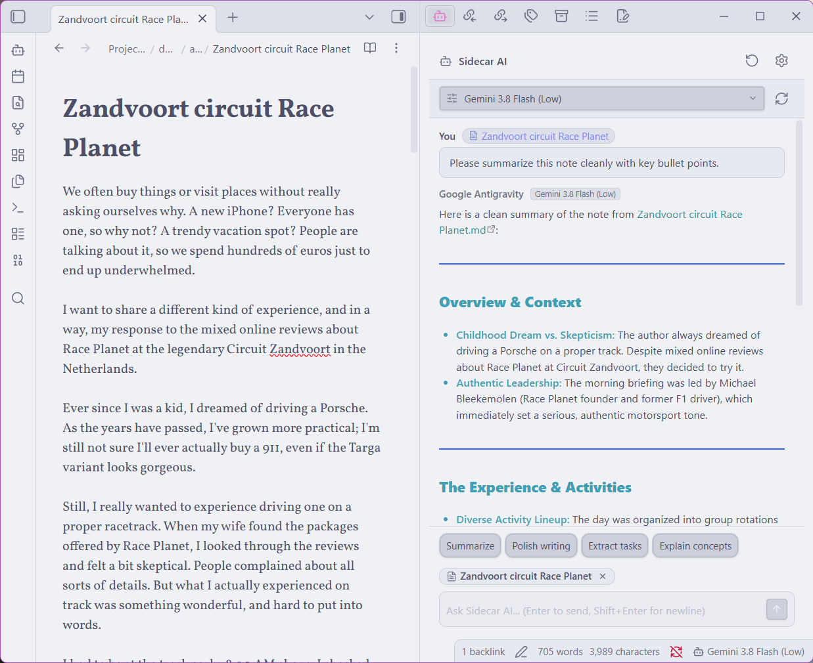

# Sidecar AI

A native, privacy-first AI chat companion for **Obsidian** powered directly by your authenticated local CLI tools: **Google Antigravity** (`agy`), **GitHub Copilot** (`copilot`), **Pi Coding Agent** (`pi`), **Claude Code** (`claude`), **OpenAI Codex** (`codex`), or any **Custom CLI** with **zero API keys, proxies, or per-token charges**.

---

## ✨ Why Sidecar AI?

Most AI plugins for Obsidian require you to manage paid third-party API tokens, configure proxies, or paste secret keys into plugin settings.

**Sidecar AI** bridges your vault directly to the command-line agents already running on your machine. It utilizes your existing subscriptions (**Google AI subscriptions**, **GitHub Copilot**, **Pi Coding Agent**, **Claude Code**, **OpenAI Codex**, or your own custom agent scripts) in a native sidebar designed to match Obsidian's interface.

---

## ⚡ Quick Start

1. **Install & Enable**: Click **Install** and then **Enable** in Obsidian Settings → Community Plugins.
2. **Ensure CLI is Ready**: Make sure at least one supported tool is installed and logged in:
   - **Google Antigravity**: run `agy` in your terminal.
   - **GitHub Copilot**: run `copilot login` in your terminal.
   - **Pi Coding Agent**: install via `npm install -g @earendil-works/pi-coding-agent` and run `pi`.
   - **Claude Code**: run `claude` (or install via Anthropic / npm) and authenticate.
   - **OpenAI Codex**: install via `npm install -g @openai/codex` and run `codex login`.
   - **Custom CLI**: have your custom binary (e.g. `super-ai`) available in your terminal or PATH.
3. **Open Sidecar AI**:
   - Click the **Sidecar AI bot icon** in the left ribbon, or
   - Press `Ctrl/Cmd + P` and select `Sidecar AI: Open chat sidebar`.
4. **Chat with Context**: Ask questions, summarize notes, or select text in your active note to query the AI assistant.
5. **Navigate Referenced Files**: Click any `file://` link produced in chat to jump directly to referenced notes and lines in Obsidian, or open external files in your default code editor.

---

## 🔌 Supported Providers

| Provider | CLI Tool | Authentication / Subscription | Supported Models |
| :--- | :--- | :--- | :--- |
| **Google Antigravity** | `agy` | Google AI Subscription | Gemini 4 Argon, Gemini 4 Hydrogen, Gemini 3.8 Flash, Claude Sonnet 5.5, Claude Opus 5.5, GPT-OSS 120B |
| **GitHub Copilot** | `copilot` | GitHub Copilot Subscription | Dynamic model list (Claude 3.7 Sonnet, Claude 3.5 Sonnet, GPT-5, OpenAI o3-mini, auto tier) |
| **Pi Coding Agent** | `pi` | Local Ollama / Google Providers | Dynamic discovery of Google and local Ollama models with Thinking controls (`Off`, `Low`, `Medium`, `High`, `Max`) |
| **Claude Code** | `claude` | Anthropic Subscription / OAuth | Dynamic model aliases (`sonnet`, `opus`, `haiku`) with reasoning effort controls |
| **OpenAI Codex** | `codex` | OpenAI Subscription / OAuth | Dynamic model discovery via `~/.codex/models_cache.json` (`GPT-6-Luna`, `GPT-5.6-Luna`, `GPT-5.6-Terra`) with reasoning effort levels |
| **Custom CLI** | Configurable (e.g. `super-ai`) | Local binary / Custom script | Any CLI agent using arguments template (e.g. `super-ai tell "<prompt>"`) |

---

## 🚀 Key Features

* 🔐 **Zero API Keys Needed**: Interacts directly with authenticated local CLI processes. No keys or billing details are ever stored in Obsidian.
* 🛡️ **Proactive Login Verification**: Checks authentication status across all installed CLIs before sending prompts, providing clear terminal commands if login is needed.
* 💬 **Multi-Turn Conversation Memory**: Subsequent messages within a chat session retain dialogue history and note context across all providers.
* 🔗 **Clickable File Links & Deep Navigation**: `file://` links produced by the AI assistant are fully interactive. Clicking vault notes opens them directly in Obsidian and scrolls to referenced lines (e.g. `#L42`) or headings; clicking external files opens them in your system's default editor (e.g. VS Code).
* 🖱️ **File Link Context Menu**: Right-click any file link in chat to **Open file**, **Open in new tab**, **Reveal in system folder** (Windows Explorer / macOS Finder), **Copy file path**, or **Copy link address**.
* 📝 **Full Text Selection & Context Actions**: Select any text across messages and code blocks. Right-click selected text or full messages to **Copy** or **Insert into note** at the current cursor position.
* 📋 **Message & Code Action Buttons**: 1-click header buttons to copy entire user prompts or assistant responses, insert responses directly into your active note, and copy individual code snippets.
* 🛠️ **Custom CLI & Agent Support**: Plug in any custom coding agent or local CLI with configurable arguments templates (e.g. `tell {prompt}`).
* 🌐 **Cross-Platform & WSL Support**: Native execution on Windows, macOS, Linux, and Windows Subsystem for Linux (`wsl`).
* 🎯 **Unified Model & Reasoning Switcher**: A single fuzzy-search modal accessible from the chat header, command palette, and plugin settings to switch providers, models, and reasoning effort levels on the fly.
* 📄 **Active Note & Selection Tracking**: Automatically references your currently focused note path (`The context: "<path>":`) and text selection as context.
* 📚 **Additional Context Attachment**: Link an additional context file or entire vault folder to prompts with interactive sidebar pill controls and smart session deduplication.
* 🏷️ **Clear Attribution**: Every assistant response clearly displays the provider, model, and reasoning effort used.
* 🔘 **Quick Action Bar**: One-click prompt chips to **Summarize**, **Polish writing**, **Extract tasks**, and **Explain concepts** from your active note.
* 🔄 **Session Management**: Dedicated *New session* button in the sidebar header to clear conversation memory and restart context on demand.
* 🎨 **Obsidian Native Design**: Strictly styled with Obsidian theme CSS variables for seamless Dark and Light mode support.

---

## 💡 Interactive Workflows

### 🔗 Deep File Navigation
When AI coding assistants generate file links (e.g. `[main.ts](file:///path/to/main.ts#L42-L60)`), Sidecar AI makes them native and clickable:
* **In-Vault Notes**: Clicking a link to a file inside your vault opens the note directly in an Obsidian leaf and scrolls immediately to the target line number (`#L42`) or heading.
* **External Files**: Files outside the vault automatically open in your operating system's default application (such as VS Code or text editor).
* **Open in New Tab**: Hold `Ctrl`/`Cmd` or middle-click on any link to open it in a new tab.
* **Right-Click Menu**: Right-click any file link to reveal the file in Windows Explorer or macOS Finder, open in a new tab, or copy the path/URL.

### 📝 Text Selection & Note Insertion
* **Full Text Selection**: Highlight any portion of assistant responses or prompts using standard mouse drag and copy via `Ctrl+C` / `Cmd+C`.
* **Right-Click Context Menu**: Right-click selected text or full messages to **Insert into note** at your cursor position, or **Copy response**.
* **1-Click Header Buttons**: Header buttons on each message allow quick copying or inserting without selecting text.

---

## ⚙️ Settings Overview

Sidecar AI supports simultaneous configuration of all AI CLI providers via collapsible cards. Configure each provider once, enable the ones you use, and seamlessly switch between them directly from the chat header or command palette.

### AI Providers (Collapsible Cards)

Each provider card (`Google Antigravity`, `GitHub Copilot`, `Pi Coding Agent`, `Claude Code`, `OpenAI Codex`) is collapsed by default and contains:

| Provider Setting | Default | Description |
| :--- | :--- | :--- |
| **Enable provider** | `false` *(off by default)* | Activate this provider for chat sessions and model selection. |
| **CLI command or path** | `agy` / `copilot` / `pi` / `claude` / `codex` | Executable command name or absolute path for the CLI. |
| **Run in WSL** | `false` | *(Windows only)* Enable if the CLI is installed inside Ubuntu/WSL. |
| **Extra CLI flags** | *(empty / recommended defaults)* | Custom arguments passed on each invocation (e.g. `--thinking high`, `--allow-all-tools`, `--dangerously-skip-permissions`). |
| **Discovered models** | *(Dynamic)* | View discovered models and click **Retrieve from CLI** to query the CLI on demand. |

> **Smart Model Discovery Cache & Auto-Refresh**:
> - Modifying any provider setting automatically re-queries models across all enabled providers in the background with targeted error notifications for the edited provider.
> - Model lists are cached for **5 minutes**. Clicking the model selector in the chat view or opening the fuzzy switcher refreshes active providers automatically if the cache is older than 5 minutes (displaying a smooth loading spinner).

### Vault Integration & Display

| Setting | Default | Description |
| :--- | :--- | :--- |
| **Auto-attach active note** | `true` | Automatically includes the active note file reference and selection in prompts. |
| **Enable context link attachment** | `false` | Enable attaching an additional context file or folder reference when sending prompts. |
| **Attach context by default** | `true` | Automatically include the context reference when starting a new chat session. |
| **Context scope** | `Single file` | Choose whether to attach a single file or a whole folder. |
| **Context path** | *(empty)* | Vault path to the context file or folder. Defaults to active note or folder if blank. |
| **Auto-scroll chat** | `true` | Automatically scrolls the chat container as responses stream in. |
| **Local process execution permission** | `false` | Acknowledge that Sidecar AI spawns local CLI processes without API keys. |

---

## 🔒 Security & System Permissions

Sidecar AI is designed with a privacy-first, zero-telemetry architecture complying with Obsidian's Community Plugin Security Guidelines:

- **Local Process Execution (`child_process.spawn`)**:
  - **Desktop-Only**: The plugin is declared desktop-only (`"isDesktopOnly": true` in `manifest.json`) because mobile platforms cannot spawn local CLI processes.
  - **No Shell Interpreter (`shell: false`)**: All process executions enforce `shell: false` to eliminate command injection vectors. Arguments are passed as structured arrays directly to the target executable.
  - **Input Sanitization**: User commands and paths are verified and sanitized against shell metacharacters (`;&|`$<>` etc.).
  - **User-Managed Binaries**: Spawns local CLI processes solely to communicate with your user-installed and authenticated AI CLI tools (`agy`, `copilot`, `pi`, `claude`, `codex`). No remote binaries or external scripts are downloaded or executed.
- **Filesystem Access**:
  - **Vault Files (`app.vault`)**: All note attachments and active context paths are verified and handled via Obsidian's native `app.vault` and `DataAdapter` APIs.
  - **External Configuration Checks**: Direct filesystem access is strictly **read-only** (`existsSync`, `readFileSync`) and scoped exclusively to detecting local CLI tool installations (e.g. `~/.pi/agent/bin/pi.cmd`) and reading user configuration files (e.g. `~/.codex/config.toml`). The plugin **never writes** to the filesystem outside of the vault.
- **Zero Fingerprinting & Identity Protection**:
  - The plugin **does not read** system identity or fingerprinting information (`os.hostname`, `os.userInfo`, or identity environment variables).
  - Directory resolution uses standard cross-platform Node APIs (`os.homedir()`) rather than identity environment variables.
- **Clipboard Access (`navigator.clipboard.writeText`)**:
  - Clipboard access is strictly **write-only**.
  - It is triggered solely when you explicitly click a user-initiated copy action (such as the "Copy" button on code blocks, "Copy response" / "Copy message" buttons on message headers, or the right-click context menu "Copy" options).
  - The plugin **never** reads, inspects, or monitors system clipboard contents.

---

## ⌨️ Command Palette Shortcuts

You can assign custom hotkeys to these commands in **Obsidian Settings → Hotkeys**:

| Command | Suggested Hotkey | Action |
| :--- | :--- | :--- |
| `Sidecar AI: Open chat sidebar` | `Ctrl+Alt+A` / `Cmd+Opt+A` | Opens or reveals the Sidecar AI sidebar view. |
| `Sidecar AI: Switch model & effort` | `Ctrl+Alt+M` / `Cmd+Opt+M` | Opens the fuzzy search modal to switch provider, model, and reasoning effort across all activated providers. |
| `Sidecar AI: Restart session (new chat)` | `Ctrl+Alt+N` / `Cmd+Opt+N` | Resets the conversation context and starts fresh. |

---

## 📚 Advanced Setup & Manual Installation

For instructions on building from source, manual installation from GitHub releases, or installing via Obsidian BRAT for beta testing, see the [Development & Manual Installation Guide](docs/DEVELOPMENT.md).

---

## ⚖️ Disclaimer

Sidecar AI is an independent community plugin and has **no affiliation with, sponsorship from, or endorsement by** any of the supported AI providers, including Google, GitHub, Anthropic, OpenAI, or their affiliates. All product names, logos, and brands are property of their respective owners.

This extension ships **as-is**, without warranty of any kind, express or implied.

---

## 📄 License

Licensed under the [MIT License](LICENSE).

---

## 🤖 Development & Transparency

* This extension was built using **Google Gemini AI**.
* Each change, implementation detail, and line of code was reviewed and verified by the author.

